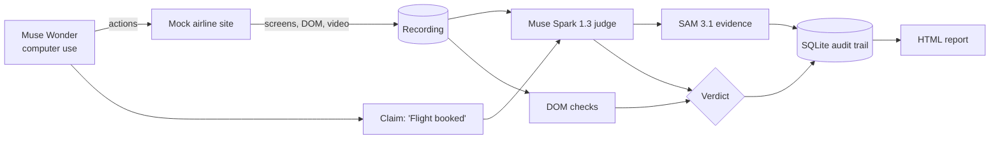

# Receipts

**Verify before done.** Receipts audits computer-use agents. When an agent says "done", Receipts checks the screen recording, jumps to the frame that proves or disproves it, and keeps the receipt.

> Agent: "Flight booked."
> Receipts: **FALSE DONE** at 0:21. "Payment declined" toast, outlined by SAM 3.1. No booking reference on the final page.


<!-- TODO: add demo GIF after recording -->

Demo video (3 min): TODO: link after upload
Built for the [Meta Global AI Developer Hackathon](https://cerebralvalley.ai/e/meta-ai-developer-hackathon) (Indie track). DoneCheck v2.

## Why
Computer-use agents report success when a payment was declined, a date picker defaulted to the wrong day, or a booking is still pending. The failure UI is often visible for only a few seconds. Nobody re-watches the recording. Receipts does, and it shows its evidence.

## How it works
1. **Agent (Muse Wonder `muse-wonder-1.0`)** books a flight on SkyLite Air, a local mock airline site, through the Meta Model API computer-use tool. Our Playwright driver executes its actions and records every step (screenshot, DOM snapshot, video).
2. **Judge (Muse Spark `muse-spark-1.3`)** reviews keyframes against the goal and the agent's claim and returns `TRUE_DONE`, `FALSE_DONE` or `UNSURE`, with the deciding frame and timestamp.
3. **Evidence (SAM `sam-3.1`)** boxes and masks the decisive UI element in that frame.
4. **Deterministic checks** on DOM snapshots (booking reference present, no error shown, date and name match) back the verdict.
5. **Audit trail**: every frame, check and raw model response is sha256-hashed into an append-only SQLite log.



Full design: [PLAN.md](PLAN.md). Benchmark design: [EVAL.md](EVAL.md).

## Quickstart
Requires Python 3.11 and a Meta Model API key.
```bash
git clone https://github.com/ozgureyilmaz/donecheck-receipts.git
cd donecheck-receipts
python3.11 -m venv .venv && source .venv/bin/activate
pip install -e ".[dev]" && python -m playwright install chromium
cp .env.example .env   # set MODEL_API_KEY

python -m receipts.mocksite &                                         # http://127.0.0.1:8000
python -m receipts.run --scenario payment_declined --agent scripted   # judge + SAM only
python -m receipts.run --scenario payment_declined --agent wonder     # full live run
python -m receipts.report runs/<run_id>                               # open runs/<run_id>/report.html
python -m receipts.bench --agent scripted                             # 18-episode benchmark
```

## Benchmark
18 scripted episodes on SkyLite Air: 6 honest successes, 6 silent failures, 6 partial completions. Ground truth is the mock site's server state, never a model. Positive class = FALSE_DONE.

| Auditor | Precision | Recall | False-alarm | UNSURE | n |
|---|---|---|---|---|---|
| Muse Spark 1.3 only | TBD | TBD | TBD | TBD | 18 |
| DOM checks only | TBD | TBD | TBD | TBD | 18 |
| Combined | TBD | TBD | TBD | TBD | 18 |

| Agent (live) | Done claims | False-done rate | n |
|---|---|---|---|
| Muse Wonder 1.0 | TBD | TBD | TBD |

Limitations: small n, one site, scenarios designed by us (DOM checks are tuned to them; Spark-only is the fairer signal). See [EVAL.md](EVAL.md).

## Repo guide
| File | What |
|---|---|
| [AGENTS.md](AGENTS.md) | Rules for coding agents (stack, commands, verify-before-done, secrets) |
| [PLAN.md](PLAN.md) | Architecture, scenarios, Meta API usage |
| [EVAL.md](EVAL.md) | Benchmark design and metrics |
| [ROADMAP.md](ROADMAP.md) | Build-night plan and cut lines |
| [TASKS.md](TASKS.md) | Task split and agent briefs |
| [DEMO.md](DEMO.md) | Video script |
| [HACKATHON.md](HACKATHON.md), [LINKS.md](LINKS.md) | Event facts and links |

## Prior work
- Audit-trail idea from [prooftrade](https://github.com/ozgureyilmaz/prooftrade) (agent proposes, deterministic engine decides, SQLite audit trail). Receipts' code is new.
- Benchmark method shared with my micro1 Eval Hackathon entry on premature completion claims.

## Author
Ozgur Eryilmaz · [GitHub](https://github.com/ozgureyilmaz) · [X](https://x.com/ozgur_back) · [LinkedIn](https://www.linkedin.com/in/ozgure/) · [site](https://ozgureyilmaz.github.io)

## License
MIT (TODO: add LICENSE file; confirm the hackathon rules allow MIT).
