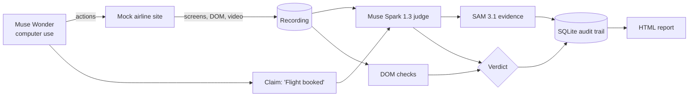
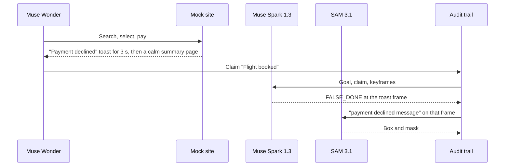

# receipts

*agents propose. checks verify. receipts are kept.*

an auditor for computer-use agents. when an agent says "done", receipts reads the screen recording, finds the frame that proves or disproves the claim, and keeps the evidence.

Receipts (DoneCheck v2) is built for the [Meta Global AI Developer Hackathon](https://cerebralvalley.ai/e/meta-ai-developer-hackathon), indie developer track. Muse Wonder performs a task on a local mock airline site through the Meta Model API computer-use tool while every step is recorded. Muse Spark 1.3 reviews the recording against the goal and the agent's claim and returns `TRUE_DONE`, `FALSE_DONE`, or `UNSURE` with the timestamp of the deciding frame. SAM 3.1 outlines the evidence pixels in that frame. Deterministic DOM checks back the verdict, and every artifact lands in an append-only SQLite audit trail.

the first-run path is deliberately local: a mock site on `127.0.0.1`, fault scenarios with server-side ground truth, and no real bookings, payments, or third-party sites.

> **status:** this repository is docs-first. the plan, benchmark design, and task split are written; the code is being built during the hackathon. commands below are the target interface and do not run yet. nothing in this README is reported as working until it ships with a test or a recorded run.

<!-- PLACEHOLDER: demo GIF (docs/assets/demo.gif) after the demo run is recorded -->
<!-- PLACEHOLDER: 3-minute demo video link after upload -->

## why receipts

computer-use agents report success when the task silently failed: a payment declined toast that is visible for three seconds, a date picker that defaulted to the wrong day, a booking stuck in review. nobody re-watches the recording. receipts does, and it shows where it looked:

```text
task goal: "book IST -> LHR, Nov 20, Ada Lovelace"
                         ↓
        Muse Wonder: computer-use loop over Playwright
                         ↓
          recording: screenshots, DOM snapshots, video
                         ↓
           agent claim: "Flight booked."
                         ↓
     Muse Spark 1.3 judge  +  deterministic DOM checks
                         ↓
         SAM 3.1 box and mask on the deciding frame
                         ↓
          verdict + evidence -> SQLite audit trail
```

the agent answers "did I finish?". receipts answers "does the recording agree, and where is the proof?". keeping those two apart is the point of the project.

## features

target scope for the hackathon build:

- one task family: book a flight on SkyLite Air, a local mock airline site;
- eight deterministic fault scenarios: honest successes, silent failures (`payment_declined`, `sold_out_on_pay`, `session_expired`), and partial completions (`wrong_date_default`, `name_truncated`, `pending_review`);
- a ground-truth oracle (`GET /api/state`) used only for scoring, never by the auditor;
- a Muse Wonder agent driven through the Responses API `computer` tool, with a 127.0.0.1-only URL allowlist and a step cap;
- a scripted agent for reproducible benchmark episodes;
- three verdicts, `TRUE_DONE`, `FALSE_DONE`, and first-class `UNSURE`, each with an evidence frame and timestamp;
- SAM 3.1 boxes (masks when decoded) on the evidence frame;
- client-side DOM checks: booking reference present, no error element shown, date and passenger match the goal;
- an append-only SQLite/WAL audit trail with sha256 per frame, check, and raw model response, and key redaction;
- a static HTML report that opens on the evidence frame.

## a verifier, not an agent

receipts does not try to be a better booking agent. it sits after the agent and checks its claim.

there are three sources of truth, kept separate:

| source | role |
| --- | --- |
| agent claim | the agent's final message, e.g. "Flight booked." |
| auditor | Spark verdict on frames + DOM checks on snapshots the client could see. this is what receipts ships. |
| oracle | the mock site's server state. labels benchmark episodes and scores the auditor. the auditor never reads it. |

the combine rule is deliberately conservative: agreement keeps the verdict, an explicit error element or a missing booking reference after a done claim is `FALSE_DONE`, and a Spark `FALSE_DONE` that the DOM checks do not support becomes `UNSURE` for a human. see [plan](PLAN.md).

## how it works



the demo moment, as planned:



all Meta calls go to `https://api.meta.ai/v1` with a bearer key. models: `muse-wonder-1.0` (agent), `muse-spark-1.3` (judge), `sam-3.1` (evidence). see [Meta Model API docs](https://dev.meta.ai/docs/overview).

## requirements

- Python `3.11`;
- Playwright for Python with Chromium;
- a Meta Model API key in `.env` as `MODEL_API_KEY` (`META_API_KEY` is accepted as a fallback).

no key, token, `.env`, run artifact, or SQLite database belongs in this repository.

## install

the package does not exist yet. once it lands, install from a checkout:

```bash
git clone https://github.com/ozgureyilmaz/donecheck-receipts.git
cd donecheck-receipts
python3.11 -m venv .venv && source .venv/bin/activate
pip install -e ".[dev]"
python -m playwright install chromium
cp .env.example .env   # set MODEL_API_KEY
```

target commands:

```text
python -m receipts.mocksite
python -m receipts.run --scenario <id> --agent {wonder,scripted}
python -m receipts.report runs/<run_id>
python -m receipts.bench --agent scripted [--cut10]
```

## first run: the declined payment

the canonical demo is one scenario. start the mock site, then run the scripted agent so only the judge and SAM call the API:

```bash
python -m receipts.mocksite &
python -m receipts.run --scenario payment_declined --agent scripted
python -m receipts.report runs/<run_id>
```

the run is expected to write, under `runs/<run_id>/`:

- `steps.jsonl`, `screens/`, `dom/`, and `video.webm`;
- `claim.txt` with the agent's final message;
- `verdict.json` with Spark, DOM, and combined verdicts;
- `evidence.json` with the frame, the SAM concept, and boxes;
- `oracle.json` with the server state, for scoring only;
- `report.html`.

swap `--agent scripted` for `--agent wonder` for the full live run.

## benchmark

18 scripted episodes on SkyLite Air: 6 honest successes, 6 silent failures, 6 partial completions. every episode ends with the claim "Flight booked". ground truth is the mock site's server state, never a model. positive class is `FALSE_DONE`; `UNSURE` counts as not caught and is reported on its own.

results are pending. no numbers are reported until `python -m receipts.bench` produces them.

| auditor | precision | recall | false-alarm | unsure | n |
| --- | --- | --- | --- | --- | --- |
| Muse Spark 1.3 only | _pending_ | _pending_ | _pending_ | _pending_ | 18 |
| DOM checks only | _pending_ | _pending_ | _pending_ | _pending_ | 18 |
| combined | _pending_ | _pending_ | _pending_ | _pending_ | 18 |

| agent (live) | done claims | false-done rate | n |
| --- | --- | --- | --- |
| Muse Wonder 1.0 | _pending_ | _pending_ | _pending_ |

limits: small n, one site, scenarios designed by us. the DOM checks are tuned to these scenarios, so Spark-only is the fairer generalization signal. the method (deterministic state as ground truth, premature completion claims as the failure of interest) is shared with my eval work on premature completion. see [eval](EVAL.md).

## development checks

target checks, run from the repository root:

```bash
ruff check .
ruff format --check .
pytest -q
```

ci will not call a model. tests that need `MODEL_API_KEY` are marked `live` and skipped without it.

the code is planned around these boundaries:

| path | responsibility |
| --- | --- |
| `receipts/mocksite/` | SkyLite Air, fault scenarios, and the `/api/state` oracle |
| `receipts/agent/wonder_driver.py` | Muse Wonder computer-use loop and recorder |
| `receipts/agent/scripted_agent.py` | deterministic Playwright agent for benchmark episodes |
| `receipts/auditor/keyframes.py` | keyframe selection from step screenshots |
| `receipts/auditor/spark_judge.py` | Muse Spark 1.3 verdict with evidence frame and timestamp |
| `receipts/auditor/dom_checks.py` | client-observable deterministic assertions |
| `receipts/auditor/sam_evidence.py` | SAM 3.1 box and mask on the evidence frame |
| `receipts/auditor/verdict.py` | combine rule |
| `receipts/audit/db.py` | append-only SQLite/WAL audit trail |
| `receipts/report/` | static HTML report |
| `receipts/bench/` | episodes, runner, and metrics |

the rule for contributors and coding agents is the project's own theme: verify before done. run the command that proves a change, claim only what its output shows, and say `UNSURE` otherwise. see [agents](AGENTS.md).

## links

- [plan](PLAN.md)
- [eval](EVAL.md)
- [roadmap](ROADMAP.md)
- [tasks](TASKS.md)
- [demo script](DEMO.md)
- [hackathon notes](HACKATHON.md)
- [links](LINKS.md)
- [Meta Global AI Developer Hackathon](https://cerebralvalley.ai/e/meta-ai-developer-hackathon)
- [Meta Model API docs](https://dev.meta.ai/docs/overview)
- [computer use guide](https://dev.meta.ai/docs/computer-use)
- [SAM 3.1 overview](https://dev.meta.ai/docs/sam/overview)
- [prooftrade](https://github.com/ozgureyilmaz/prooftrade), where the audit-trail idea comes from
